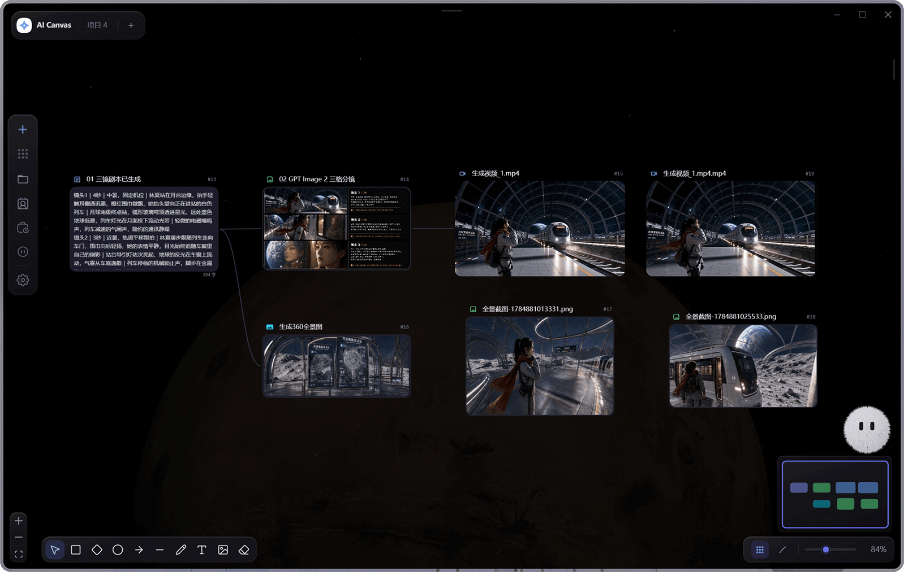

# MTV Open · MTV 导演画布（开源版）

> **本项目是 [AI Canvas Tauri](https://github.com/Tenney95/AI-Canvas-tauri) 的派生版（fork）**，
> 在原项目基础上做了大量界面重构与「与上游官方产品逐像素对齐」的改造，并重命名/独立发布为 **MTV Open**。
> 原始版权归上游作者所有，许可证沿用上游（见 [License](#license)）。改动清单见[与上游的差异](#与上游的差异)。


<p align="center">
  
</p>

> 基于 **Tauri 2 + React 19 + React Flow 12** 的本地优先 AI 多模态画布与对话 Agent 桌面应用。

MTV Open 将文本、图像、视频、音频、逐帧动画、Markdown、分镜、360° 全景和手绘笔记组织成可连接的画布节点。你可以在同一个项目中编排生成链路、管理角色库与本地素材、执行 ComfyUI 工作流、安装 JavaScript 或可信 Python 用户插件，也可以通过对话助手查询或修改画布、生成媒体、派出只读子智能体、读取授权文件并沉淀项目记忆。项目还能拆成剧集与分集，一部短剧的每一集各占一张画布，角色库与素材整部剧共用。


**发布状态：** 本仓为新建的独立开源仓，尚未提供线上演示与安装包；上游项目见 [AI Canvas Tauri](https://github.com/Tenney95/AI-Canvas-tauri)。

**构建方式：** 见下方[快速开始](#快速开始)（`npm run tauri build` 或双击 `build-exe.cmd`）。

[核心能力](#核心能力) · [快速开始](#快速开始) · [项目文档](#项目文档) · [License](#license)

> 用户插件、文件系统、凭据存储、独立窗口、3D 导演台、本地模型等能力依赖 Tauri 桌面环境，请按下方步骤启动桌面应用。

## 界面预览



## 核心能力

| 能力 | 说明 |
| --- | --- |
| 多模态节点画布 | 文本、图像、视频、音频、逐帧动画、Markdown、分镜、全景、3D 导演台、源文件和画布笔记统一连接。支持小地图分类统计、远景轻节点与渐进显示；原图与画布数据保留。 |
| AI 与工作流 | 云端模型、自定义模型执行协议、ComfyUI 多服务器、RunningHub 云工作流/AI 应用、通用工作流 API（含 AutoDL H3 模板）、Dreamina 和本地 ONNX 推理。工作流参数、上传、进度和任务恢复按平台处理。 |
| 用户插件 | 从本地、市场或 GitHub Release 安装 JavaScript / 可信 Python 插件，扩展工具、节点与宿主管理的界面。JavaScript 使用 QuickJS 沙箱；Python 拥有当前用户权限。入口摘要与完整 revision 摘要共同校验，停用或换版本后旧调用不能继续写回。 |
| 剧本与分镜制作 | 原著章节浏览、分集创作工作台、剧本快照、镜头改稿与补图，准备配音/视频/导演节点，并把对白字幕与已就绪配音推送时间轴。角色动作素材可通过 @ 引用。 |
| 内置视频剪辑 | 独立编辑器支持多轨编排、裁剪与分割、画面变换、转场、文字、贴纸和音量调整，可无损直通或合成导出。MCP 另有创建/修改工程、后台导出、媒体探测与抽帧入口。 |
| 对话 Agent | 多会话、流式响应、Plan/B/C 三种执行模式、工具调用、审批卡片、任务时间线、上下文压缩和项目记忆。 |
| 只读子智能体 | 用户自定义领域角色；主任务按需派出并行只读子智能体，产出脱敏后回传。 |
| 角色与创作资产 | 项目/全局角色卡、多参考图、声音与动作素材，以及人物、场景、道具的提取、简介和绑图。 |
| MCP 外部控制 | 默认关闭，支持本机 stdio 和需额外配置确认的 Streamable HTTP；默认按需发现工具。可批量导入媒体、分块上传图片、粘贴系统内容、截图入画布和操作剪辑工程。MCP 按自动生成模式执行，用户选择仍需本人回答。 |
| 本地存储与设置保护 | 项目媒体落盘，结构化数据保存在 IndexedDB，API Key 由 Rust 凭据存储隔离。设置按修改字段保存并检测冲突；失败保留草稿，提供重试或重新加载，退出前等待保存。 |
| 剧集与分集 | 每集独立画布，整部剧共享角色库、项目记忆与素材目录；助手可根据剧本批量创建分集。 |
| 资产库与预览 | Tab 开关左侧资产库，项目文件、全局资产、创作资产和节点列表分别浏览。节点卡片支持定位与拖线；图片全屏按编号切换，视频悬浮播放，输出历史可固定。支持可恢复删除与桌面 .aicanvas 项目包。 |
| 新手引导与帮助 | 首启引导、按场景组织的帮助中心与可离线打开的操作说明书；说明 @ 引用、ComfyUI 输入、快捷键及自定义接口配置。 |
| 双运行时 3D 导演台 | 轻量导演台按需安装自身资源；Blender 高级编辑支持 Windows x86_64 与 macOS Intel/Apple Silicon，当前支持 4.5、5.0、5.1、5.2 稳定系列。保存返回须校验当前镜头 PNG 与 .blend 工程。 |

文档覆盖 0.9.7 及截至 2026-09-11 的后续源码更新；已发布安装包可能不包含后续功能。操作步骤见[操作说明书](site/manual.html)，开发职责与验收入口见[文档导航](doc/文档导航.md)。

## 技术栈

| 技术 | 用途 |
| --- | --- |
| [Tauri 2](https://tauri.app/) + Rust | 桌面壳、窗口、文件、更新、本地模型与系统能力 |
| [React 19](https://react.dev/) + TypeScript 6 | UI、领域类型和严格类型检查 |
| [React Flow 12](https://reactflow.dev/) | 节点画布、连线与视图控制 |
| [Zustand 5](https://zustand.docs.pmnd.rs/) | Slice 化全局状态管理 |
| [Tailwind CSS 3](https://tailwindcss.com/) | 组件样式与 `canvas-*` 设计 token |
| [Vitest](https://vitest.dev/) | 自动化测试 |
| IndexedDB | 本地结构化数据持久化 |

## 快速开始

### 环境要求

- Node.js：满足 Vite 8 的运行要求，建议使用当前 LTS
- npm
- Rust stable toolchain
- Blender 高级编辑（可选）：Windows x86_64 或 macOS Intel/Apple Silicon，4.5 / 5.0 / 5.1 / 5.2 稳定系列；轻量导演台不依赖 Blender。
- 对应平台的 [Tauri 系统依赖](https://v2.tauri.app/start/prerequisites/)

Windows 构建还需要 Visual Studio Build Tools 2022，并安装“使用 C++ 的桌面开发”工作负载。

### 安装依赖

```bash
npm install
```

### 启动开发环境

```bash
# 仅启动 Web 前端，默认访问 http://localhost:1420
npm run dev

# 启动完整 Tauri 桌面应用
npm run tauri dev
```

Web 模式适合界面开发；用户插件、原生对话框、本地文件工具、独立窗口、本地模型和 3D 导演台等能力需要 Tauri 桌面环境。

### 检查与构建

```bash
# TypeScript 类型检查
npm run typecheck

# ESLint 检查
npm run lint

# 单元测试（Vitest）
npm run test

# lint + 类型检查 + 测试
npm run check

# 前端生产构建
npm run build

# 桌面应用构建
npm run tauri build
```

版本以 `package.json` 为源。`npm run sync-version` 当前只同步 `README.md` 版本徽章和 `src-tauri/Cargo.toml`；Tauri 配置、其他语言 README、站点与说明书需分别核对，见[打包与发版流程](doc/打包与发版流程.md)。

### 已知限制

- **测试套件**：`tests/` 继承了上游的用例，其中一部分与当前类型定义已经漂移（`npm run test:typecheck` 会报既有类型错误），另有若干组件测试失败。
  因此本仓的 CI 与发版流水线**目前只跑 `lint` + `typecheck` + `build`**，`npm run test` 保留给本地使用。欢迎 PR 逐条修掉。
- **界面素材**：见下方[素材与第三方声明](#素材与第三方声明)。

## 项目文档

- [操作说明书](site/manual.html)
- [模块文档导航](doc/文档导航.md)
- [开发指南](doc/开发指南.md)：环境、命令、目录、开发约定、调试和常见问题
- [架构说明](doc/架构说明.md)：核心模块、数据流、安全边界和性能设计
- [插件开发规范](doc/插件开发规范.md)：Manifest、JavaScript/Python 运行时、自定义节点、权限、安全边界、安装更新与发布规范
- [开源插件开发示例：逐帧拉片](https://github.com/luckcatlin2000/ai-canvas-video-frame-review-plugin)：参考自定义界面、授权视频抽帧、模型分析、线稿转换与分镜节点输出；插件需用户单独安装。
- [ComfyUI 工作流集成说明](doc/ComfyUI工作流集成说明.md)：导入、IO 节点识别、内容与参数注入、结果取回
- [对话式画布助手功能方案](doc/对话式画布助手-功能方案.md)
- [对话助手 Agent 能力实施方案](doc/对话助手-Agent能力实施方案.md)
- [打包与发版流程](doc/打包与发版流程.md)

架构决策记录位于 [`doc/adr/`](doc/adr/)。

## 与上游的差异

MTV Open 相对上游 AI Canvas Tauri 的主要改造（全部可追溯，逐条对应代码注释里的取证位置）：

- **界面 1:1 重构**：模型下拉（两行版式：名称行 + 标签行、说明卡）、参数胶囊（比例 / 清晰度 / 精细度 / 张数）、生成确认卡、
  对话气泡与工具时间线、节点加载动画（星阵 / 扫光 / 抖动遮罩）等，均按上游官方产物的 DOM、类串、几何尺寸逐项对齐。
- **焦点编辑（Point to Edit）**：点图取元素 → 画布白框 + 标签条（✨ + 元素名 + 多候选下拉），
  识别结果以 `{{magic_item:{…}}}` 元数据写进提示词，并在输入框里渲染成官方同款芯片；退出模式时自动补「目标图 → 本节点」连线。
- **多平台接入**：内置中转站厂商（如土豆）与自定义连接，模型目录 / 分组价目 / 可用性（`/v1/models` 权威清单）联合判定；
  模型映射表把上游 id 归一到官方展示名；不再把上游自有的付费/权益概念硬编码进界面。
- **生成链路**：图像异步任务（提交 + 轮询）、参数按模型能力表收敛（不该发的参数不发）、
  渠道级参数限制（如免费池渠道只收 2K + low/medium）在菜单里置灰并给出可操作的错误提示。
- **对话 Agent**：多会话、工具子步骤、审批卡片、任务时间线、上下文压缩、项目记忆。
- **工作区**：首页 composer / 项目画廊 / 技能面板，创建项目与画布的一批细节规则。

## 素材与第三方声明

- 仓库内含若干**从上游官方产品产物中提取的派生资源**（图标、字体栈外的界面色值/尺寸常量、模型元数据 JSON、i18n 文案等），
  仅用于还原界面外观。这些资源的权利归其原始权利人所有，本项目**不对其授予任何许可**；对外分发或商用前请自行评估风险并替换为自己的素材。
- 画布笔记的工具条与属性面板视觉参考 [Excalidraw](https://github.com/excalidraw/excalidraw)（MIT，见 `doc/licenses/`）。
- 本项目与任何模型厂商、中转服务商**无隶属关系**，不随附任何 API Key；所有模型调用均使用使用者自己的凭据。

## 免责声明

本项目按「现状」提供，不附带任何明示或默示担保。使用者需自行确保：所使用的模型服务条款允许其用途、
所生成内容的合法性与版权合规、以及遵守所在地区法律法规。因使用本项目产生的任何后果由使用者自行承担。
## License

本项目采用 **AI Canvas Tauri Source-Available License**，完整条款见 [LICENSE](LICENSE)。

允许学习、研究、内部使用、修改和集成使用。禁止未经授权的套壳销售、白标分发、源码转售、商业再分发及将本项目作为同类产品进行商业化。

本项目并非 OSI 定义下的开源项目。如需商业授权，请联系版权方。

### 第三方素材

画布笔记的工具条与属性面板视觉设计参考自 [Excalidraw](https://github.com/excalidraw/excalidraw)，其许可证见 [doc/licenses/excalidraw-MIT.txt](doc/licenses/excalidraw-MIT.txt)。


## 代码贡献

<p>
  <a href="https://github.com/zhurui0523" title="zhurui0523"></a>
  <a href="https://github.com/stars-one" title="stars-one"></a>
  <a href="https://github.com/luckcatlin2000" title="luckcatlin2000"></a>
  <a href="https://github.com/xiaozangao" title="xiaozangao"></a>
  <a href="https://github.com/orlova851986-debug" title="orlova851986-debug"></a>
</p>
